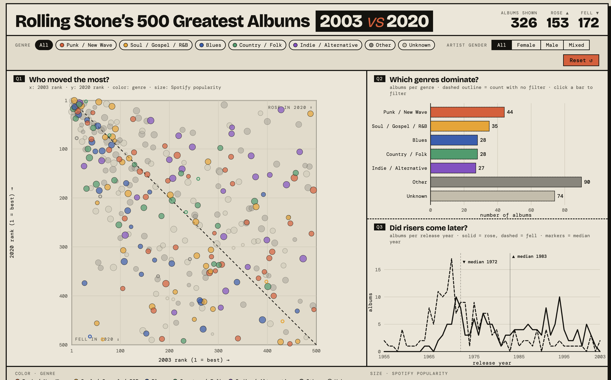
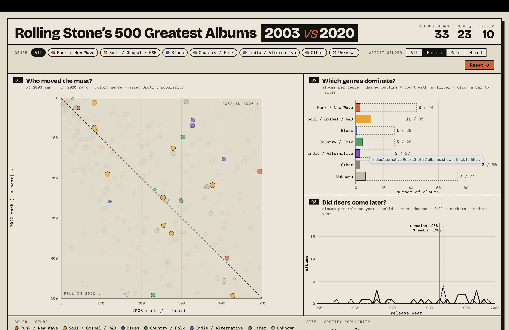

# InfoWiz: Rolling Stone's 500 Greatest Albums, 2003 vs 2020

An interactive dashboard that compares Rolling Stone's 2003 and 2020 rankings of the 500 greatest albums of all time. It shows which albums rose or fell, which genres dominate (and how that changes for female artists), and whether the albums that rose are more recent than the ones that fell.

**Course:** Information Visualisation, Mini Project 02 (Mid Submission: Working Prototype)
**Author:** Shivam Singh
**Hosted prototype:** `<PASTE HOSTED LINK HERE>`
**Stack:** Vite + React + D3 (D3 computes scales; React draws the SVG)

---

## Screenshots






---

## Research questions and views

| # | Question | View | What to look at |
|---|---|---|---|
| Q1 | Which albums moved up or down the most between 2003 and 2020, and what genres were they? | **Scatterplot** | Distance from the dashed no-change line |
| Q2 | Which genres are most represented, and how does that change when filtered to female artists? | **Bar chart** + gender filter | Bars shrink inside a dashed outline showing the unfiltered count |
| Q3 | Are the albums that rose released more recently than the ones that fell? | **Line chart** | Vertical median markers for risers and fallers |

### Findings so far
- 326 albums are on both lists: **153 rose, 172 fell, 1 unchanged**.
- Biggest risers: *Voodoo* (D'Angelo, +460), *The Blueprint* (Jay-Z, +414), *Kid A* (Radiohead, +408). Biggest fallers: *The Anthology* (Muddy Waters, -445), *Back to Mono* (Phil Spector, -425).
- Median release year: **1983 for risers, 1972 for fallers**, so risers are typically about 11 years more recent.
- Female artists are 7.7% of the 2003 list and 18.7% of the 2020 list (computed over albums with a known gender). Among the 326 plotted albums, 33 are female: 23 rose and 10 fell. Soul/Gospel/R&B has the most (11 of 35).

---

## Data

- **Source:** Rolling Stone's 500 Greatest Albums of All Time (2003, 2012, 2020 lists), compiled by The Pudding and released through TidyTuesday on 2024-05-07 (`rfordatascience/tidytuesday`).
- **Raw size:** 691 albums x 21 columns (691 because the three lists contain different albums).
- **Plotted:** the **326** albums that appear on **both** the 2003 and 2020 lists, because the main chart needs both ranks.
- **Cleaned file:** `public/data/albums_clean.json` (326 rows x 12 columns).

| Column | Type | Used for |
|---|---|---|
| `rank_2003`, `rank_2020` | Quantitative | Scatterplot x and y |
| `rank_change` | Quantitative | Tooltip; derived (2003 rank minus 2020 rank, positive = rose) |
| `direction` | Categorical | rose / fell / same, derived from `rank_change` |
| `genre`, `genre_group` | Categorical | Color; `genre_group` has 7 values |
| `spotify_popularity` | Quantitative (0 to 100 score) | Dot size |
| `release_year` | Ordinal | Line chart x |
| `artist_gender` | Categorical | Filter (Female / Male / Mixed) |
| `id`, `clean_name`, `album` | Identifier / labels | Tooltips; `id` is unique per row |

### Cleaning steps (done in Python with pandas)
1. Loaded the raw file and confirmed 691 x 21.
2. Kept only albums with both a 2003 and a 2020 rank (326 remain).
3. Added `rank_change` and checked it against the dataset's own `differential` column (matched on all 326 rows).
4. Added `direction` from the sign of `rank_change`.
5. Fixed a genre typo ("Blues/Blues ROck" merged into "Blues/Blues Rock").
6. Labeled blank genres (74 albums) and the one blank gender "Unknown", so they stay on the chart.
7. Grouped genres into `genre_group`: top 5 genres + "Other" + "Unknown" = 7 categories.
8. Added a unique `id` per album (some titles repeat, e.g. "Let It Be").
9. Exported `albums_clean.json`.

### Data quality summary
- **Completeness:** only `spotify_popularity` has nulls (18 of 326, shown as small hollow marks). 74 genres are "Unknown" (22.7%).
- **Uniqueness:** no duplicate rows or duplicate (artist, album) pairs. `rank_2003` contains tied ranks (a feature of the original 2003 list), so `id` is used as the identifier, never a rank.
- **Consistency:** `rank_change` and `direction` agree on all rows; ranks are within 1 to 500; release years run 1955 to 2003; no stray whitespace in text columns.

---

## Visual encodings (channel table)

| Data variable | Type | Mark | Channel | Reason |
|---|---|---|---|---|
| 2003 rank | Quantitative | Dot | Position (x) | Position on a common scale is the most accurate channel for comparing numbers |
| 2020 rank | Quantitative | Dot | Position (y) | Same scale as x, so the diagonal is a true no-change line |
| Genre | Categorical | Dot, bar | Color (hue) | Genre has no order, so hue fits; capped at 7 colors because viewers cannot reliably separate more |
| Spotify popularity | Quantitative | Dot | Size (area) | Area is read imprecisely (Stevens' power law), so it carries a secondary variable; exact value is in the tooltip |
| Albums per genre | Quantitative | Bar | Length (common scale) | Bars start at zero, so lengths compare honestly |
| Release year | Ordinal | Line | Position (x) | Time runs left to right by convention |
| Albums per year | Quantitative | Line | Position (y) | Position on a common scale |
| Rose vs fell | Categorical | Line | Line style (solid / dashed) | Hue is already used for genre, so a second hue meaning would conflict |
| Missing Spotify data | n/a | Dot | Hollow fill | Makes "missing" look different from "low" |
| Filtered-out albums | n/a | Dot | Opacity (faded) | Keeps context while a filter is on |

### Changes from the proposal
- Genre color is limited to **7 categories** (top 5 genres + Other + Unknown), following feedback that no more than 7 hues should encode a variable.
- The plotted set is the **326** albums on both lists (not all 691).
- Rose vs fell in the line chart is encoded with **line style**, not color.
- The gender filter has four options: All, Female, Male, **Mixed** (the dataset's "Male/Female" value).
- Added: median-year markers (line chart), a dashed "unfiltered count" outline (bar chart), and an on-screen no-change diagonal label.

---

## Interaction

- **Hover** a dot for a tooltip (album, artist, year, both ranks, change, genre, Spotify popularity). Hover the line chart for counts per year.
- **Genre chips** and **gender control** filter all three views at once. **Reset** clears them.
- **Click a bar** to filter to that genre (click again to clear); the scatterplot dims the other dots and the line chart updates.
- All filter state lives in one place (`App.jsx`), so every view reads the same selection.
- Not yet built: **brushing** (drag a box on the scatterplot to update the other two views).

---

## Run it locally

Requires Node.js 18 or newer.

```bash
npm install        # one time: installs react, d3, vite
npm run dev        # starts the dev server at http://localhost:5173
npm run build      # creates the hostable site in dist/
npm run preview    # serves dist/ locally to test the build
```

### Deploy (Vercel or Netlify)
Import the GitHub repository. Build command: `npm run build`. Output directory: `dist`. The Vite config uses a relative base (`./`), so it also works on GitHub Pages.

---

## Project structure

```
infowiz/
├── index.html                  page shell; loads fonts; has <div id="root">
├── package.json                dependencies and scripts
├── vite.config.js              build settings
├── docs/screenshots/           README screenshots (add these)
├── public/data/albums_clean.json
└── src/
    ├── main.jsx                entry point: mounts <App />
    ├── App.jsx                 loads data, holds filter state, lays out the dashboard
    ├── constants.js            genre colors, gender options, dot-size scale
    ├── styles.css              all styling
    ├── hooks/
    │   ├── useAlbums.js        fetches the JSON
    │   └── useSize.js          measures a chart's pixel size
    └── components/
        ├── Panel.jsx           frame for one view
        ├── FilterBar.jsx       genre chips, gender control, reset
        ├── Legend.jsx          color / size / diagonal legend
        ├── Scatterplot.jsx     Q1
        ├── BarChart.jsx        Q2
        └── LineChart.jsx       Q3
```

---

## Known limitations
- About half the marks are gray: "Other" (90) and "Unknown" (74) are 164 of 326 albums, because the dataset leaves many genres unlabeled. Unknown genres cluster among classic-rock and pop acts.
- Only 33 plotted albums are by female artists, so the filtered bar chart is suggestive, not conclusive.
- Release years stop at 2003, because an album must be on the 2003 list to be plotted; Q3 cannot speak about later albums.
- Spotify popularity is a snapshot from when the dataset was compiled, not popularity in 2003 or 2020.
- The 2003 list has tied ranks; source name typos (e.g. "John Prince") were left as they are.
- Dense regions of the scatterplot overlap; brushing and zoom are planned.

## AI assistance
 AI usage that was done to create this project is Claude, and the references that I use is
Claude, the, the PPTs that were taught in class. And I studied them through YouTube, the
PPTs, and I understood them through Claude. The dataset came from me. I drafted the
research question. However, I did take help to understand how those research questions will
be represented using the data that I'm putting on.

## Credits
Data: The Pudding / TidyTuesday (2024-05-07), based on Rolling Stone's lists. Libraries: React, D3, Vite.
