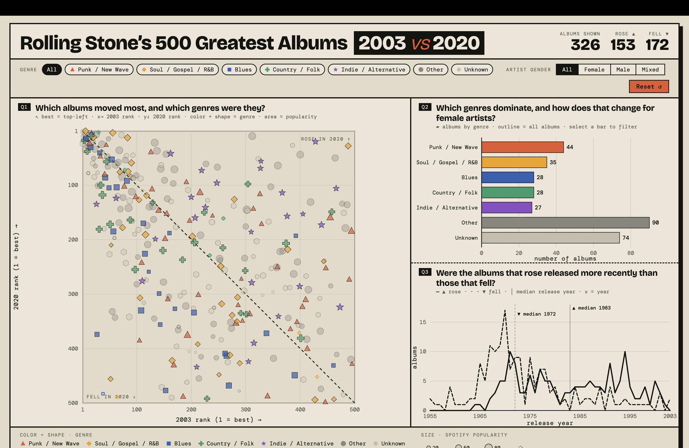
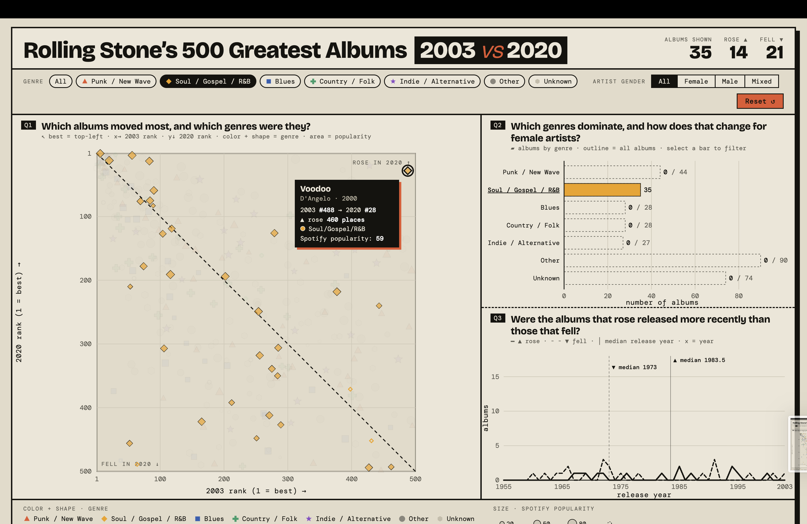

# InfoWiz: Rolling Stone's 500 Greatest Albums

**Mini Project 02 — Information Visualisation**<br>
**Author:** Shivam Singh<br>
**Email:** ss21645@nyu.edu<br>
**NetID:** ss21645

[Open the hosted dashboard](https://vamcodes.github.io/InfoVis/)

This project compares Rolling Stone's 2003 and 2020 album rankings through three linked views. It focuses on the 326 albums that appear on both lists and explores rank movement, genre representation, and release-year patterns.

## Research questions

1. Which albums moved up or down the most between the 2003 and 2020 rankings, and which genres were they?
2. Which genres are most represented, and how does that change when filtering to female artists?
3. Were the albums that rose in rank released more recently than the ones that fell?

## Dashboard views and interactions

- **Scatterplot:** 2003 rank on the x-axis, 2020 rank on the y-axis, a diagonal for no rank change, genre shown by both color and shape, and Spotify popularity shown by mark size. Rank 1 is best on both axes, so the top-left is the best-ranked region. Focus a point with the keyboard to view its album details; arrow keys move between points.
- **Genre bar chart:** number of albums in each grouped genre. Select a bar to filter the other views.
- **Release-year line chart:** yearly counts for albums that rose and fell. Both series use ink-colored marks: a solid line with an up triangle marks albums that rose, and a dashed line with a down triangle marks albums that fell. Median-year markers support comparison.
- **Shared filters:** genre and artist-gender controls update all three views. Reset returns to the full dataset.

## Peer feedback and changes

Peer feedback led to clearer rank-direction labels, genre shapes alongside color, keyboard access to album details, shorter question subtitles, and a more visible key on the release-year chart. The rise/fall series are distinguished by line pattern and direction symbols, with both shown in ink. The genre shape mapping is repeated in the scatterplot, legend, and genre filter chips.

The review also identified interpretation issues: one response said more 1960s albums rose, although 12 rose and 52 fell; another selected Punk / New Wave as the most common genre in the top-100-in-both-years region, where the counts are Other 18, Unknown 15, and Punk / New Wave 5. Brushing on the line chart and scatterplot is not implemented yet, so those selection tasks still need to be retested after brushing is added.

## Reports

- [Usability Test Report (PDF)](reports/User_testaibility.pdf)
- [Reflection Report (PDF)](reports/reflection%20report.pdf)

The reports use `ieeeconf.cls` v1.1. They can be compiled in Overleaf when that class file is available in the project.

## Screenshots

### Dashboard overview



### Female artist filter and album detail



## Data

The source dataset contains 691 albums and 21 columns covering the 2003, 2012, and 2020 lists. The dashboard uses the 326 albums that have both a 2003 and a 2020 rank. The cleaned dashboard data is `public/data/albums_clean.json` (326 rows).

The project uses rank, genre, Spotify popularity, release year, artist gender, and derived rank-change direction. Genre is grouped into the five most represented categories, Other, and Unknown. Missing Spotify popularity is shown as a hollow mark.

**Sources:** [TidyTuesday Rolling Stone Album Rankings, 2024-05-07](https://rfordatascience.github.io/tidytuesday/data/2024/2024-05-07/readme.html); [The Pudding's Rolling Stone rankings essay](https://pudding.cool/2024/03/greatest-music/).

## Visualization principles

- **Cleveland and McGill:** rank comparisons use position on aligned axes; the bar chart uses length on a common baseline.
- **Stevens' power law:** a square-root radius scale makes circle area proportional to Spotify popularity, which remains a secondary encoding.
- **Gestalt proximity, enclosure, and similarity:** the bar and line charts are grouped together, a common border encloses the dashboard, and repeated genre colors and shapes connect views.
- **Visual hierarchy and data-ink:** the scatterplot is the largest view because rank movement is the primary question; light gridlines support reading without competing with marks.

## Run locally

Requires Node.js 18 or newer.

```bash
npm ci
npm run dev
```

To create and preview a production build:

```bash
npm run build
npm run preview
```

## Deploy

The GitHub Actions workflow at `.github/workflows/deploy.yml` builds and deploys the site to GitHub Pages when changes are pushed to `main`. Check the repository's **Actions** tab for the deployment status.

## AI assistance

Claude and Codex assisted with clarifying visualization concepts, exploring encodings, and implementing and revising the dashboard. I selected the dataset and topic, formulated the research questions, and reviewed the work using course materials and peer feedback.
